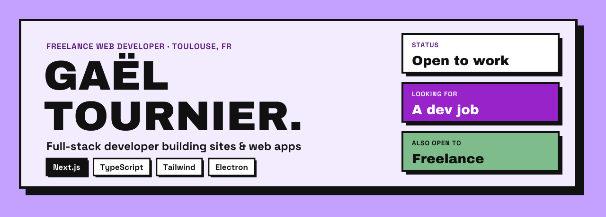
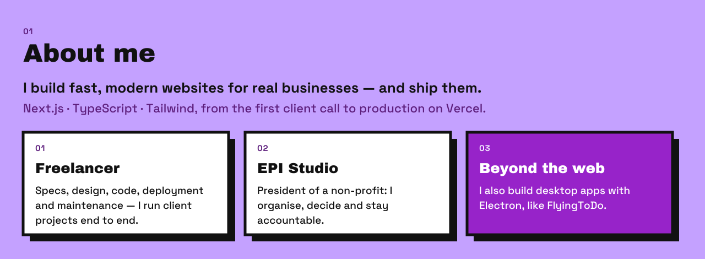
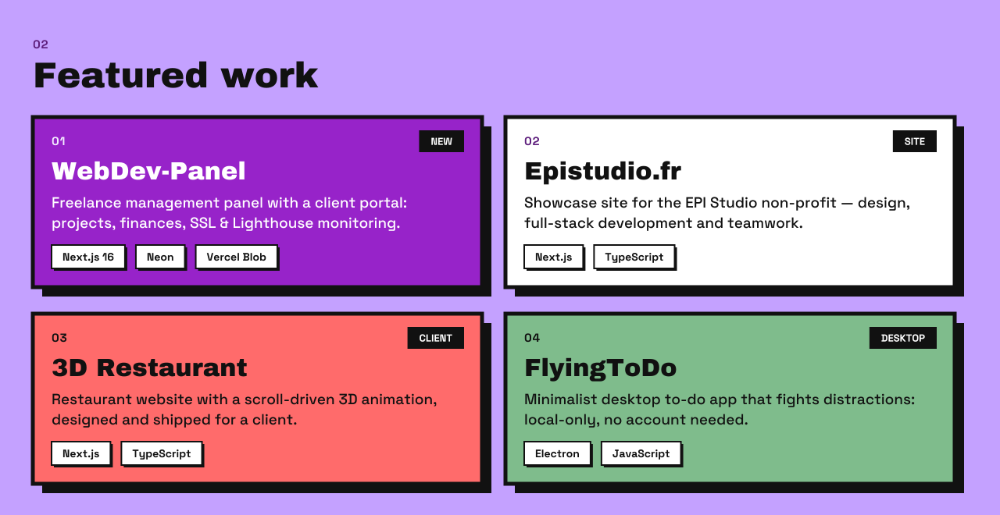
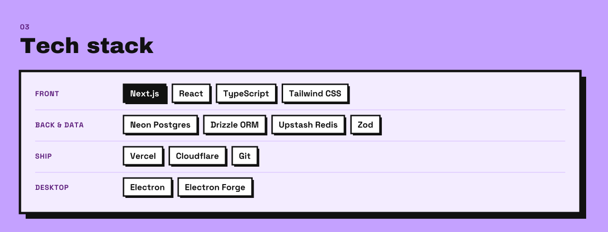
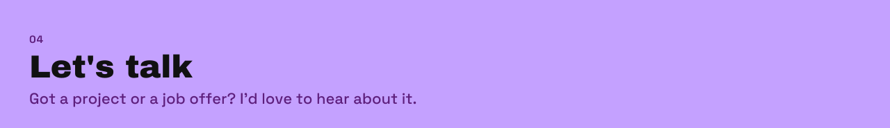
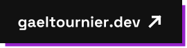
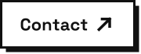

<!--
  Profile README for FlyingCow31, in the WebDev-Panel neo-brutalist design system.
  Put this file + the assets/ folder at the root of the public repo named exactly "FlyingCow31".
  Text in the SVGs is converted to paths (Archivo Black + Space Grotesk), so it renders identically everywhere.
-->

&nbsp;

&nbsp;

  

&nbsp;

&nbsp;

&nbsp;

